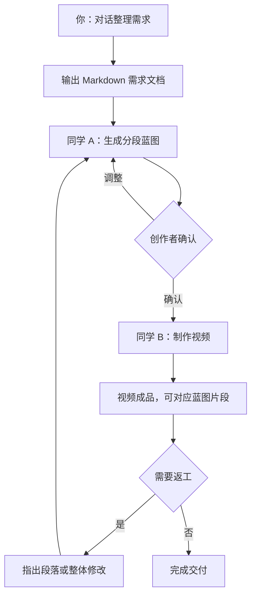

# 交接 3：三人分工与施工计划

**状态：** 根据最新讨论制定的工作草案。A、B 是两位编码同学的临时代号；蓝图格式和 DSH 调用方式待验证。

## 分工

| 成员 | 负责内容 | 交给下一位什么 |
| --- | --- | --- |
| 你 | 与创作者沟通，整理 Markdown 视频需求；探索 MCP 或 DSH 聊天模块；准备测试内容和后续 PPT、宣讲 | 讲稿或具体内容、用户明确要求，以及验证过的提交方式 |
| 同学 A | 蓝图与主流程：接收需求、生成可确认的分段大纲、处理回到蓝图的修改 | 用户确认后的蓝图，段落可识别 |
| 同学 B | 视频输出：根据蓝图规划画面、制作视频，让成片内容能对应蓝图 | 可观看的视频和实际可用的片段定位方式 |

具体任务在三人用样例确认蓝图后细化。涉及接入代码、通信和合并，由有编码基础的同学协助审核。

## 流程

## 施工顺序

1. **共同确定蓝图初稿：** 你提供真实讲稿，A 提出分段大纲和识别方式，B 检查是否足够制作和返工。
2. **先打通需求到蓝图：** 你探索提交路径；A 根据需求生成蓝图，并让创作者查看和确认。B 可并行用蓝图样例测试视频方案。
3. **跑通蓝图到成片：** B 根据确认后的蓝图生成可观看视频，确保团队能从视频找到对应蓝图片段。
4. **验证一次返工：** 你提出修改，A 回到蓝图调整并确认，B 根据更新后的蓝图重新生成。允许整条重新生成。
5. **完成交付：** 三人共同检查真实结果；你据此整理素材、PPT 和宣讲。

第一版不预设独立试讲修改界面、精确时间表、专门的版本系统或自动局部重生成。

## 演示题目与关键画面：三人怎么配合

选题与关键画面尽早并行验证，不必等整套工作台全部完成。具体展示安排仍可在成片完成后决定。

| 工作 | 你：需求与产品 | 同学 A：蓝图与主流程 | 同学 B：视频输出 |
| --- | --- | --- | --- |
| 选题 | 提出 2—3 个历史或文科候选问题，准备简短讲稿和可核对的材料 | 判断题目是否容易拆成清楚的叙事段落 | 判断关键画面是否能在现有时间和技术条件下实现 |
| 定关键画面 | 说清观众要理解什么，以及创作者希望看到什么变化 | 在对应蓝图片段保留讲解内容和用户明确的画面意图 | 选择可行的表现方式，制作约 10—15 秒样片 |
| 检查效果 | 邀请未看过原稿的人观看，记录是否看懂、画面是否有帮助 | 核对蓝图是否保留用户意图且没有过度限定实现 | 根据反馈调整关键画面的节奏、对应关系和可读性 |
| 接入完整流程 | 把选定内容整理为需求文档，并记录输入与调用结果 | 从需求生成、调整并交付用户确认的蓝图 | 基于确认的蓝图生成完整视频，并保留可定位的段落对应关系 |
| 对外表达 | 整理“用户要求 → 蓝图 → 成片”的实际案例；成片稳定后制作 PPT 和宣讲 | 说明蓝图如何承接用户要求 | 提供真实样片与成片，说明制作方式及实际限制 |

**选择题目的共同标准：** 一句话能理解、有疑问或反差、核心内容适合画面变化、范围适合团队实现、演示材料可以核对。先围绕一个知识点做出有解释作用的画面，不以动画数量为目标。

**样片通过标准：** 一位未看过讲稿的观众能够说出关键画面要解释什么；团队能指出它对应的用户要求和蓝图片段。此标准是小范围验证，结果如实记录。

## 试用记录

由你联系一位不会剪辑的组外用户，用其内容或团队样例尝试流程；三人记录用户操作、需要开发者协助的地方、人工操作时间、总生成时间和实际调用费用。再请几位没看过原稿的观众观看关键画面，记录是否理解。具体人数和结果以实际为准。

若完整视频生成耗时较长，展示时可以使用事先真实生成的成片或修改前后结果，并说明哪些步骤提前完成；不承诺现场完成尚未验证的能力。

## 关键交接

- **你 → A：** 一份能说明讲什么的需求或讲稿，以及用户明确要求；实质影响生成的信息不足时由 A 反馈。
- **A → 创作者 → B：** 分段蓝图及可识别的段落，由创作者确认后交给视频模块。
- **B → 团队：** 视频和一套实际可用的蓝图定位方式；返工时指出对应段落并回到蓝图修改。

## 最小验收

- [ ] 真实需求能交给蓝图负责人，产出用户能确认的分段蓝图。
- [ ] B 用蓝图生成一条可观看的视频，团队能找到视频内容对应的蓝图片段。
- [ ] 一次修改能回到蓝图并形成重新生成的视频。
- [ ] 所选 MCP 或 DSH 路线完成一次实际调用；内部交接和外部入口的验证结果分别记录。
- [ ] 选定一个符合选题标准的演示案例，完成一段关键画面样片并收集观众反馈。
- [ ] 能对应展示一条用户要求、蓝图片段及成片画面；相关体验、耗时和费用以实测为准。

如果人工传文件用于验证蓝图，只代表蓝图交接通过，不代表 MCP 或 DSH 已经接通。演示安排在产品做出来后再决定。
