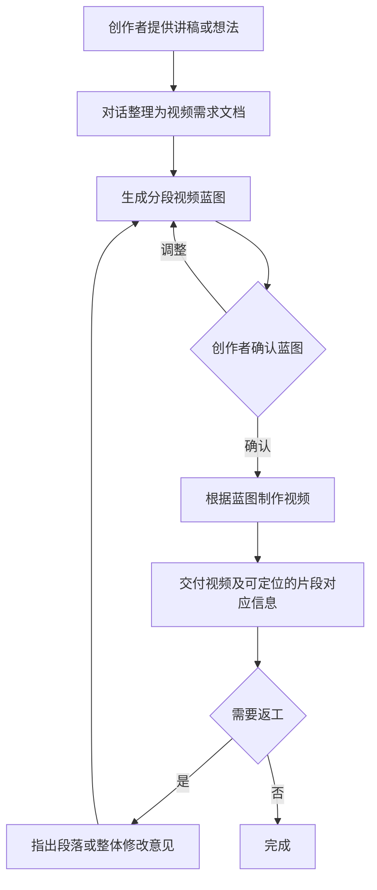

# 知识视频创作工作台 PRD

> 早期开发记录。当前产品范围、安装方式及会员规则见[仓库首页](README.md)。

**版本：** 黑客松第一版需求草案，依据团队最新讨论整理  
**参考项目：** OpenMAIC，具体代码复用方式待验证

## 一、产品目标

帮助有内容和表达意愿、但不会或不擅长视频制作的创作者，把自己的讲稿或想法制作成知识讲解视频。第一版先跑通一个历史或其他文科知识场景，面向泛兴趣观众。

产品重点是把创作者提供的内容整理成可确认的蓝图，再制作视频。用户不需要知道动画代码或组件名称。蓝图和视频内容应能对应，便于生成后找到需要返工的段落。

## 二、用户与输入

- **用户：** 有自己的知识、观点或故事，希望通过视频表达，但缺少剪辑或动画制作能力的人。
- **输入：** 讲稿、较详细的内容描述，或通过对话整理出来的创作需求。用户可以补充目标观众、风格、画面想法和其他要求。
- **输入不足时：** 仅当缺失的信息实质影响蓝图生成时，请用户补充。已经能说明内容的讲稿可直接交接，不要求填写所有可选信息。
- **需求整理与接入：** 由需求负责人探索 MCP 或 DSH 聊天模块，输出 Markdown 格式的单次视频需求文档。具体路线及外部调用方式待验证。

## 三、产品流程

## 四、核心需求

### 4.1 需求整理

1. 接收创作者的讲稿、口语表达或其他描述，整理出视频主题、主要内容和用户明确提出的要求。
2. 保留用户提出的观点和约束；整理口语及叙事结构时，不能把模型猜测写成用户明确提出的内容。
3. 只在关键信息不足以生成蓝图时追问。时长、画幅、参考资料等只有用户提供或实际制作需要时才填写。
4. 使用 Markdown 交接单次视频需求；输入由 MCP 或 DSH 等何种方式送达，待实际调用验证。

### 4.2 分段蓝图

1. 根据需求生成按顺序排列的视频大纲，每段应能让创作者理解讲什么，并能在后续被定位。
2. 用户明确提出的画面、表达方式或其他要求应保留；未指定的表现形式由视频模块规划。
3. 蓝图可以帮助组织叙事，用户在视频生成前查看并确认，也可提出修改。
4. 蓝图无需强制规定镜头细节、动画方式、技术组件或代码。格式在 Markdown、JSON、YAML 中由开发同学用样例验证后选择。
5. 每条成片应能找到其对应的蓝图；具体通过文件、会话或其他方式关联，由实现者确定，无须预设专门的版本系统。

### 4.3 视频制作与交付

1. 视频模块根据已确认蓝图制作视频，安排与讲述相配合的画面和声音。
2. 第一版以一种统一风格跑通一个文科知识案例；具体风格和视频规格待团队选定。
3. 输出可观看、可交付的视频，并能依据蓝图找到相应内容段落。具体定位方式由视频模块验证；不预设必须制作精确时间表。
4. 生成失败或未完成时应清楚告知，不将其作为成品交付。

### 4.4 返工

创作者看完成片后，如有不满意的部分，可指出某段或提出整体结构修改。团队依据蓝图定位修改内容，回到蓝图调整、确认后重新生成。第一版暂不要求独立试讲修改界面，也不要求自动只重生成单个片段；重新生成范围由实际实现决定。

## 五、第一版范围

| 范围 | 内容 |
| --- | --- |
| 第一版目标 | 需求整理 → 分段蓝图 → 用户确认 → 视频生成 → 能定位并返工 |
| 当前交付物 | Markdown 视频需求文档、可确认的蓝图、可观看的视频、足以定位内容的对应信息 |
| 接入待验证 | MCP 或 DSH 聊天模块如何接收需求并交给蓝图模块；是否能从具体外部聊天工具直接调用 |
| 暂不作为必做 | 独立试讲界面、自动局部重生成、复杂需求访谈、多套视觉风格、理科物理引擎 |
| 不作为本版目标 | 自动事实核验和来源追溯；创作者提供的内容由其确认 |

## 六、验收

- [ ] 使用一份真实讲稿或内容描述，整理出能交给蓝图模块的需求；仅对阻碍生成的缺失信息追问。
- [ ] 生成有明确顺序、内容和可识别段落的蓝图，保留用户明确的要求，并在制作视频前获得确认。
- [ ] 根据确认后的蓝图生成一条可观看、可交付的文科知识视频。
- [ ] 对照成片，能找到某个内容对应的蓝图片段；定位方式由团队根据实现选择。
- [ ] 对一条修改意见，回到相应蓝图调整、确认，并依据更新后的蓝图重新生成。可整条重新生成。
- [ ] 用实际调用验证所选接入方式；内部模块交接和外部聊天工具接入分别记录实际结果。
- [ ] 演示成片至少有一处关键画面变化，用来解释知识，而不只是装饰；请未看过讲稿的人观看并说出理解了什么。
- [ ] 能指出用户的一条画面要求、蓝图中的对应内容，以及成片中如何体现。

视频时长、画幅、生成时间、费用、具体模型、风格及演示选题尚未确定，由团队结合实际资源决定。

## 七、演示题目与关键画面

这一部分用于指导比赛案例制作，不改变产品支持范围。选题和画面均需用实际成片验证。

### 7.1 怎么选择演示题目

优先选择一个历史或文科问题，满足以下条件：

1. **容易进入：** 用一句话就能提出问题，泛兴趣观众不需要大量背景也能听懂。
2. **有观看动力：** 有一个值得解释的疑问、反差或故事转折，而非罗列知识点。
3. **适合画面讲解：** 核心概念能通过路线、时间线、地图、人物关系或空间变化表现出来。
4. **范围够小：** 能在短时间内讲清一个重点，适合三人团队的实现能力。
5. **材料可核对：** 团队能找到足以核对演示内容的资料，明确区分示意画面和实际史料。这里是演示内容准备，不要求产品实现自动事实核验。

选题示例：“丝绸之路为什么不只是一条路？”可探索从一条路线逐渐展开为路线网络的画面。它只是候选示例；具体内容、历史依据和是否采用均由团队决定。

### 7.2 怎么做好关键画面

围绕选定题目，先找出**一个最值得用画面解释的知识点**，写清四件事：

- 观众需要理解什么？
- 画面在讲解前是什么状态，讲解过程中发生什么变化？
- 创作者对此有哪些明确要求，蓝图怎样表达？
- 看完成片后，观众能否说出这个变化帮助解释了什么？

先制作一段约 10—15 秒的关键画面样片，验证画面、旁白和节奏是否配合；时长仅作为试验建议，不是成片规格或功能门槛。样片可用当前最容易实现的方式制作，确认效果后再融入完整视频。

建议至少保留一条可见的对应关系：**创作者的画面要求 → 蓝图中对应的段落 → 成片里的实际呈现**。用户未指定的画面细节仍由视频模块规划，不要求蓝图变成逐帧分镜。

### 7.3 展示和效果验证

- 展示时可先播放关键画面，再说明用户的输入、蓝图和最终画面之间的关系。具体演示安排待产品完成后确定。
- 如展示修改前后对比，记录哪些步骤真实运行、哪些结果提前生成；不要把重新生成整条视频说成已实现局部重生成。
- 邀请一位不会剪辑的组外用户试用，记录其操作、所需协助、人工操作时间、总生成时间及实际调用成本；这些数据以实测为准。
- 邀请几位没看过原稿的观众看片，询问他们是否理解了关键知识点，以及关键画面起了什么作用。少量反馈用于改进演示，不作为普遍学习效果的证明。
